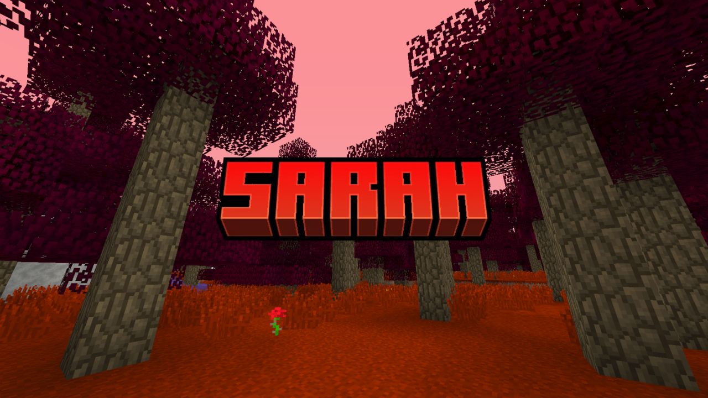

# Sarah

Sarah is a build setup tool to generate Makefiles from Visual Studio projects (specifically LCE ones) for the purpose of building (crosscompiling) them on Linux

## Why

Yes.. and because piebot said so

## Requirements

- A C++20 compiler (PLEASE JUST USE CLANG)
- CMake 3.20 or newer
- GNU Make
- `clang-cl` and `llvm-lib` for the Windows64 platform
- An `xwin` SDK/CRT tree for the Windows64 platform
- WINE and `fxc.exe` when Windows64 shader headers need to be regenerated

## Build Sarah

```sh
cmake -S . -B build -G Ninja
cmake --build build
```

## Usage

Run Sarah from the directory that contains the solution:

```sh
sarah setup build
```

Sarah (not me, the tool) creates a `build/` directory containing everything like a `.stamp` and stuff

Build the default configuration:

```sh
make -C build Windows64
```

Build a specific configuration:

```sh
make -C build Windows64 CONFIG=Debug
```

Supported configurations are taken from the solution. For `MinecraftConsoles.sln` (from Cafeberry) the Windows64 configurations are `Debug`, `Release`, `ContentPackage`, `ContentPackage_NO_TU`, `CONTENTPACKAGE_SYMBOLS`, and `ReleaseForArt`.

If a solution or project file changes, the generated Makefile reruns Sarah automatically before building.

## Post-build staging

When a project has a post-build event that references a `postbuild.ps1` script, Sarah reads the script if it exists and translates its directory, file, and folder-copy operations into shell commands in the generated Makefile (in a very terrible way). PowerShell is not required (because I'm lazy to make it so).

Run the built application under WINE:

```sh
make -C build run
make -C build run CONFIG=Debug
```

Set `WINE` if the launcher is not on `PATH`.

Useful options:

```sh
sarah setup build --root /path/to/project
sarah setup build --solution /path/to/Project.sln
```

## Platform modules

Platforms are implemented as separate modules. A platform module decides how a solution platform maps to project configurations, which toolchain to use, and which extra dependencies or setup steps are required.

The `xwin` tree defaults to `~/.xwin` and can be overridden with `SARAH_XWIN`. Tool paths can be overridden with `SARAH_CLANG_CL`, `SARAH_LLVM_LIB`, and `SARAH_FXC`.

## License

Sarah is licensed under the [GPL-3.0](LICENSE) license.
